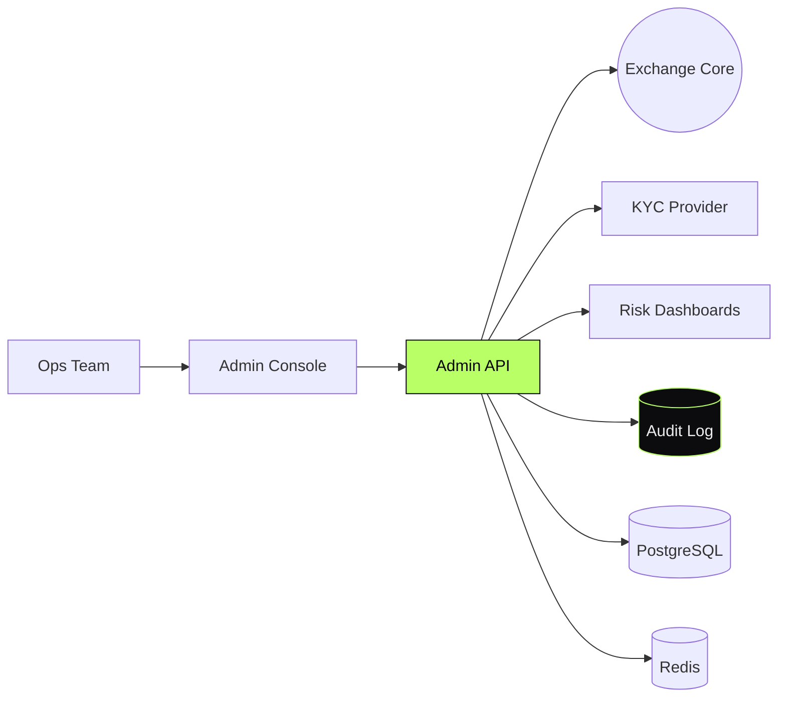

<div align="center">

```
    ██████╗███████╗██╗  ██╗
   ██╔════╝██╔════╝╚██╗██╔╝
   ██║     █████╗   ╚███╔╝
   ██║     ██╔══╝   ██╔██╗
   ╚██████╗███████╗██╔╝ ██╗
    ╚═════╝╚══════╝╚═╝  ╚═╝
```

# CEX Admin Control Plane

#### The control plane for a centralized exchange.
#### Orders · balances · KYC · risk · ops console.

[](#)
[](#)
[](#)
[](#)

</div>

---

> **TL;DR** — The admin side of a CEX: the system the ops team uses to
> run the exchange. Not user-facing — the layer that keeps the lights on.

---

## Overview

A complete operator console and backend for a centralized exchange.
Covers customer lifecycle, order management, balance reconciliation, KYC
workflows, risk dashboards, and audit logging.

Designed for an ops team that handles real money — every action is
traceable, every override is auditable.

> This repository documents the system at the **architectural level**.
> Implementation code is private.

---

## My Role

> **Lead Engineer.** Owned the full admin stack.

- Backend service and API design (NestJS, PostgreSQL, Redis)
- Operator console (Next.js)
- Authentication, RBAC, and audit pipeline
- KYC workflow integration
- Risk dashboards
- Reconciliation tooling

---

## Architecture



---

## Capabilities

- **Order management** — pause, cancel, settle, dispute
- **Balance reconciliation** — internal ledger vs custody truth
- **KYC workflows** — submission, review, escalation, decision
- **Risk dashboards** — exposure, anomalies, fraud signals
- **Append-only audit log** — every privileged action recorded with payload
- **RBAC** — least-privilege roles by function

---

## Architectural Decisions & Tradeoffs

### 1. Append-only audit, separate from operational store

Audit lives in its own append-only store. No operator can rewrite history.
Cost: extra storage. Value: incident forensics is possible.

### 2. Every override is a signed action

Privileged actions carry the operator identity and a reason. Compliance
review can ask *who and why* months later.

### 3. Console is dumb, API is smart

Business logic lives in the API. The console is a typed UI on top. Changes
to policy ship to the API; the console picks them up on next load.

---

## Engineering Invariants

- **Never** mutate balances outside the ledger
- **Never** override without an audit record
- **Never** trust the console with policy decisions
- **Never** reconcile by guess — always against custody truth

---

## Related Public Documents

- [`weway-launchpad`](https://github.com/eldardzh/weway-launchpad) — adjacent fintech architecture
- [`grafana-observability-stack`](https://github.com/eldardzh/grafana-observability-stack) — ops dashboards

---

<div align="center">

#### **Contact**
[**eldardzh.com**](https://eldardzh.com) · [**@EldarDissmay**](https://x.com/EldarDissmay) · **dissmay21@gmail.com**

<sub>© 2026 · Eldar D.</sub>

</div>
